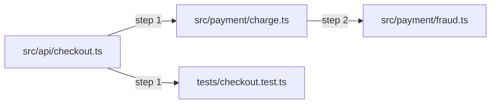

<!-- risk-gate:report -->
## Risk Gate

- **Risk:** `danger`
- **Status:** `FAILED`
- **Merge blocked:** `true`
- **Version:** `0.1.0`

### Why this risk

- `src/api/checkout.ts` → **danger** (rule `src/api/`); modules: `chargeCard`, `checkout`, `items`, `token`, `total`, `items`, `sum`, `item`, `sum`, `chargeCard`, `total`

### Cascade impact

- `src/api/checkout.ts` is connected to `src/payment/charge.ts` → **danger** (rule `src/payment/`): Payments and authorization; chain: `src/api/checkout.ts` → `src/payment/charge.ts`
- `src/api/checkout.ts` is connected to `tests/checkout.test.ts` → **minimal** (rule `tests/`); chain: `src/api/checkout.ts` → `tests/checkout.test.ts`
- `src/api/checkout.ts` is connected to `src/payment/fraud.ts` → **danger** (rule `src/payment/`): Payments and authorization; chain: `src/api/checkout.ts` → `src/payment/charge.ts` → `src/payment/fraud.ts`

### AST analysis

Parsed files: `40`; incomplete files: `4`.

The following files require attention:

- `.github/workflows/risk-gate.yml`: unsupported language
- `.risk-gate.yaml`: unsupported language
- `scripts/mutation-test.sh`: unsupported language
- `scripts/test-e2e.sh`: unsupported language

### Validations

- `e2e`: `SUCCESS` (exit: `0`; 4048 ms)
  - stdout: `12 scenarios passed`
- `mutationTesting`: `FAILED` (exit: `1`; 6019 ms)
  - stderr: `3 mutants survived in src/payment/charge.ts`

_Generated by risk-gate._

